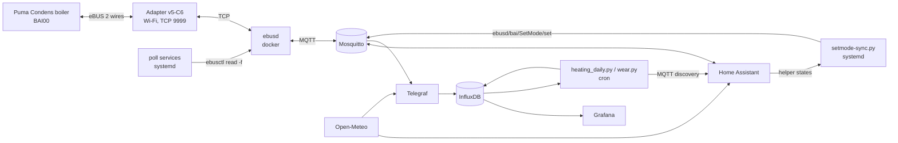

# Protherm Puma Condens 24/28 + eBUS + Home Assistant: full control and monitoring without a room controller

[Українська](README.md) | **English**

How I control a **Protherm Puma Condens 24/28 MKV-AS/1** gas combi boiler from Home Assistant over eBUS: heating and DHW setpoints, weather-compensated heating, thermostat cards, alerts, gas accounting, charts and analytics. There is **no** Vaillant/Protherm room controller (VRC700, sensoCOMFORT, MiGo, ThermoLink): Home Assistant acts as the controller and sends the boiler a `SetMode` command.

Running since July 2026, through a full heating season.

> Entity names and UI labels in the configs are in Ukrainian (e.g. «Котел» = boiler, «Опалення» = heating, «ГВП» = DHW / hot water). Rename them freely; just keep the helper entity IDs in sync with `setmode-sync.py`.

---

## 1. Hardware

| What | Details |
|---|---|
| Boiler | Protherm Puma Condens 24/28 MKV-AS/1 (combi, underfloor heating via a mixing group) |
| Bus identity | `MF=Vaillant;ID=BAI00;SW=5011;HW=1303`, product ID `0010026149` |
| eBUS adapter | ebusd adapter **v5-C6** (ESP32-C6) on the boiler's eBUS terminals, Wi-Fi/TCP (`ens:` = enhanced mode) |
| Server | single-board computer running Armbian + Docker |
| Phone | Home Assistant Companion (Android) for push notifications |

## 2. Architecture



Everything runs on one server: `ebusd`, `homeassistant`, `influxdb:2.7`, `telegraf`, `grafana` in Docker, Mosquitto on the host.

### Repository layout

```
ebusd/docker-run.sh                 ebusd container
server/setmode-sync.py              daemon that sends SetMode to the boiler
server/ebusd-flame-poll.sh          forced polling of flame/modulation/DHW/pressure (3 s)
server/ebusd-temp-poll.sh           forced polling of flow/return temperature (5 s)
server/systemd/*.service            units for the three scripts + closing port 8888
server/cron/root.crontab            infrequent forced reads (counters, error code)
server/cron/heating_daily           cron for analytics
homeassistant/packages/kotel.yaml   EVERYTHING for HA: sensors, helpers, weather curve, thermostats, automations
homeassistant/dashboards/kotel.json boiler dashboard (sections view)
monitoring/telegraf.conf            MQTT -> InfluxDB + weather
analytics/heating_daily.py          gas split heating/DHW, gas per degree-day
analytics/wear.py                   component wear estimate -> HA (MQTT discovery)
```

### Installation (short)

1. **Adapter and ebusd.** Wire the adapter to the boiler's eBUS terminals, put its IP into `ebusd/docker-run.sh` and run it. Check with `docker exec ebusd ebusctl info`: you should see `signal: acquired` and `scanned "MF=Vaillant;ID=BAI00..."`.
2. **Mosquitto** on the host (port 1883) and the MQTT integration in HA.
3. **Home Assistant.** Copy `homeassistant/packages/kotel.yaml` to `config/packages/` and add to `configuration.yaml`:
   ```yaml
   homeassistant:
     packages: !include_dir_named packages
   ```
   In the package, replace `notify.mobile_app_YOUR_PHONE` with your notify service and the coordinates in `rest:` with yours. After a restart you get the sensors, helpers, `climate.kotel_opalennia` and `climate.kotel_gvp`.
4. **Control.** Put `server/setmode-sync.py` into `/usr/local/bin/`. Set the path to your HA database in the script (`DB = ...home-assistant_v2.db`): it reads helper states directly from SQLite. It needs `mosquitto_pub` (package `mosquitto-clients`). Copy the units to `/etc/systemd/system/`, then run `systemctl daemon-reload` and `systemctl enable --now setmode-sync ebusd-flame-poll ebusd-temp-poll ebusd-block-lan`. Add the crontab entries from `server/cron/`.
5. **Dashboard.** Create a new dashboard, open "Edit → Raw configuration editor" and paste `homeassistant/dashboards/kotel.json` (JSON is valid YAML). It needs these HACS cards: `mushroom`, `mini-graph-card`, `apexcharts-card`. The component-wear cards appear after the first `wear.py` run.
6. **History and analytics (optional).** InfluxDB 2 + Telegraf with `monitoring/telegraf.conf` (token in the `INFLUX_TOKEN` env variable) + Grafana. Put the scripts from `analytics/` into `/root/heating_log/` and run them from cron.

## 3. ebusd

```bash
docker run -d --name ebusd --network host --restart unless-stopped \
  -v /opt/ebusd/config:/etc/ebusd/config \
  john30/ebusd:latest \
  --device=ens:<ADAPTER_IP>:9999 \
  --scanconfig --configpath=https://ebus.github.io/ \
  --latency=50000 --pollinterval=5 \
  --mqtthost=127.0.0.1 --mqttport=1883 --mqttjson --mqtttopic=ebusd \
  --mqttclientid=ebusd --mqttchanges --mqttretain \
  --mqttint=/etc/ebusd/config/mqtt-hassio.cfg --mqttverbose \
  --mqttvar=filter-direction=r|u|^w \
  --httpport=8889 --enabledefine \
  --accesslevel=install
```

Notes:

- **`--accesslevel=install` is required for writes.** Without it `SetMode` is silently ignored: no error, the boiler just never gets it.
- ebusd loads `vaillant/08.bai.csv` + `vaillant/bai.308523.inc`. There is no dedicated definition for HW=1303 / product 0010026149, so the fallback `bai.308523.inc` is used. Most registers read fine, but about 14 return a zero-length response (`/ 00`), meaning they don't exist in this firmware (see section 10).
- `mqtt-hassio.cfg` gives HA auto-discovery (1400+ entities). I don't use them directly: all needed sensors are defined by hand (section 5), and `*.ebusd_bai_*` is excluded from the recorder to keep the database small.
- The control port 8888 is closed to the LAN (ufw + an iptables rule), localhost only.

## 4. Control: `SetMode` and `setmode-sync.py`

### 4.1 The SetMode command

The boiler accepts `bai SetMode` from a "controller". Fields (from the current ebusd config):

```
hcmode ; flowtempdesired ; hwctempdesired ; hwcflowtempdesired ; disablehc ; disablehwctapping ; disablehwcload ; remotecontrolhcpump ; releasebackup ; releasecooling
```

Publishing via MQTT:

```bash
mosquitto_pub -t ebusd/bai/SetMode/set -m "auto;50;43;43;0;0;0;0;0;0;0;0"
#                                        hcmode;flow;DHW;DHW;...
```

Verified in practice (on two identical boilers, SW 5011 and 5013):

| Parameter | What the boiler accepts |
|---|---|
| Heating flow `flowtempdesired` | 20…75 °C. ≤15 means "no heating demand", ≥80 is clamped to 75 (= d.71) |
| DHW `hwctempdesired` | 25…55 °C. ≤20 means "no DHW demand", ≥60 is clamped to 55 (= d.20) |
| `hcmode` | **not controllable over the bus**: summer/winter (heating off/on) is switched only with the button on the boiler panel |
| Timeout | without repeated commands the boiler keeps the setpoint for at most ~16 min, then falls back to the panel values |

Because of the timeout, the command has to be repeated continuously, not sent once.

### 4.2 The `/usr/local/bin/setmode-sync.py` script

A daemon under systemd (`Type=simple`, `Restart=always`, `RestartSec=5`). Logic:

- Reads four HA helpers:
  - `input_boolean.boiler_heating_switch` + `input_number.boiler_heating_temp` (35–60 °C);
  - `input_boolean.zapit_na_gvp_kotla` + `input_number.temperatura_gvp_kotla` (35–55 °C).
- Reads them **directly from the HA recorder database (SQLite, read-only)**, no REST API or token.
- If both switches are off, it writes nothing: the boiler panel is in control.
- If at least one is on, it sends `SetMode`. For a circuit whose switch is off, it sends the boiler's current value (`FlowTempDesired` / `StorageTempDesired`) so the panel setting is not overridden (passthrough).
- Pace: every **2 s** while there is activity (flame, hot water draw, or a switch on), and every **60 s** when idle.
- Values are range-checked before sending. Every write is logged to `/var/log/setmode-sync.log`.

```python
def run_once():
    heating_on = get_state("input_boolean.boiler_heating_switch") == "on"
    hwc_on     = get_state("input_boolean.zapit_na_gvp_kotla") == "on"
    if not (heating_on or hwc_on):
        return                      # boiler panel is in control

    flowtemp = get_state("input_number.boiler_heating_temp") if heating_on \
               else ebus_read("FlowTempDesired")          # passthrough
    hwctemp  = get_state("input_number.temperatura_gvp_kotla") if hwc_on \
               else ebus_read("StorageTempDesired")       # passthrough

    payload = f"auto;{flowtemp:g};{hwctemp:g};{hwctemp:g};0;0;0;0;0;0;0;0"
    subprocess.run(["mosquitto_pub", "-h", "127.0.0.1",
                    "-t", "ebusd/bai/SetMode/set", "-m", payload])
```

## 5. Sensors in Home Assistant

Defined by hand under `mqtt:` (stable `unique_id`s). Example:

```yaml
mqtt:
  sensor:
    - name: "Котел: Температура подачі (факт)"   # Boiler: flow temperature (actual)
      unique_id: kotel_temperatura_podachi_fakt
      state_topic: "ebusd/bai/FlowTemp"
      value_template: "{{ value_json.temp.value }}"
      unit_of_measurement: "°C"
      device_class: temperature
      state_class: measurement
  binary_sensor:
    - name: "Котел: Полум'я"                     # Boiler: flame
      unique_id: kotel_polum_ia
      state_topic: "ebusd/bai/Flame"
      value_template: "{{ value_json.value.value }}"
      payload_on: "on"
      payload_off: "off"
```

Full list: water pressure; flow (actual and desired); return; flow and return from `Status01`; modulation; DHW setpoint (`StorageTempDesired`); pump mode; operating hours for heating, DHW and pump; heating and DHW start counts; current error (`Currenterror`); flame ionisation level; hot water flow (`HwcWaterflow`); safety temperature limiter (STB) trip counter; failed ignitions (total and per attempt 1–4); 3-way valve position; flame.

### 5.1 Forced polling

ebusd's passive cache for some values could stay stale for hours while the boiler is idle, even with `--pollinterval=5`. Hence separate systemd services (`bash while true` + `docker exec ebusd ebusctl read -f <field>`, `Restart=always`):

| Service / cron | Fields | Period |
|---|---|---|
| `ebusd-flame-poll.service` | Flame, ModulationDesired, HwcWaterflow, HwcDemand, WaterPressure | 3 s |
| `ebusd-temp-poll.service` | FlowTemp, ReturnTemp | 5 s |
| cron | StorageTempDesired, HwcWaterflow | 2 min |
| cron | HcHours, HwcHours, PumpHours, HcStarts, HwcStarts, Currenterror, IonisationVoltageLevel | 1 h |

To check how fresh a value is: `ebusctl find -V -e <field>`, look at `lastup` (UTC).

### 5.2 Derived (template) sensors

- **Actual load:** `ModulationDesired` often stays at 25 % (burner minimum) while idle. So load = modulation when there is a flame, otherwise 0.
- **Burner on DHW:** flame + hot water flow > 0.
- **DHW overheat:** flow ≥ 85 °C during a hot water draw or within 90 s after it (`delay_off` 2 min), plus `history_stats` counters "overheats today / last 7 days", "DHW starts today / last hour".

### 5.3 Gas accounting (estimated)

The gas meter is not electronic, so consumption is calculated from modulation:

```yaml
- name: "Котел: Розрахункова витрата газу"     # estimated gas flow, m³/h
  state: >-
    
              {# Qmax of the DHW circuit, from the datasheet #}
      {# fitted to the real gas meter #}
    
      {{ ((modulation / 100) * max_gas_kw / calorific_kwh_m3) | round(3) }}
     0 
```

Then `integration` gives m³ and `utility_meter` gives daily and monthly totals. There is a helper for the real meter reading and the gas price. After calibrating the calorific value against the real meter, the error is about 2 % per day.

## 6. Weather-compensated heating (in Home Assistant)

The boiler has no outdoor sensor, so the outdoor temperature comes from **Open-Meteo** (no API key). Underfloor heating reacts slowly, so the **average of the next 12 hours of forecast** is used instead of the current temperature:

```yaml
rest:
  - resource: https://api.open-meteo.com/v1/forecast?latitude=<LAT>&longitude=<LON>&current=temperature_2m&hourly=temperature_2m&forecast_hours=12&timezone=Europe%2FKyiv
    scan_interval: 900
    sensor:
      - name: "Outdoor temperature"
        value_template: "{{ value_json.current.temperature_2m }}"
      - name: "Outdoor temperature 12h"
        value_template: >-
          
          {{ (t | sum / t | count) | round(1) }}
```

Curve (linear interpolation between points):

| Outdoor, °C | −12 | −7.5 | −2.5 | +2.5 | +7.5 | +12 |
|---|---|---|---|---|---|---|
| Flow, °C | 60 | 58 | 55 | 51 | 48 | 45 |

```yaml
template:
  - sensor:
      - name: "Heating weather target"
        unique_id: opalennia_temp_za_pogodoiu
        unit_of_measurement: "°C"
        state: >-
          
          {{ none }}
            
            
            
            
            
              
                
                
                  
                
              
            
            {{ ns.v | round(0) | int }}
          
```

Switch: `input_boolean.opalennia_za_pogodoiu`. The "weather heating" automation runs when the switch changes, when the target changes, every 30 min and at HA start. It writes the target into `input_number.boiler_heating_temp` and turns on `boiler_heating_switch`; `setmode-sync.py` then sends it to the boiler. Turning the switch off hands control back to the panel.

The 45 °C minimum is deliberate: below that the boiler short-cycles more, and the floor temperature is limited by the mixing group anyway.

## 7. Thermostat cards on the dashboard

To get standard `thermostat` cards instead of switches and sliders, there are two virtual `climate` entities via MQTT. They are just a wrapper around the same four helpers:

```yaml
mqtt:
  climate:
    - name: "Котел: Опалення"                    # Boiler: heating
      unique_id: kotel_climate_opalennia
      modes: ["off", "heat"]
      mode_command_topic: "ha/kotel/opalennia/mode/set"
      mode_state_topic: "ha/kotel/opalennia/mode"
      temperature_command_topic: "ha/kotel/opalennia/temp/set"
      temperature_state_topic: "ha/kotel/opalennia/temp"
      current_temperature_topic: "ebusd/bai/FlowTemp"
      current_temperature_template: "{{ value_json.temp.value }}"
      action_topic: "ha/kotel/opalennia/action"
      min_temp: 35
      max_temp: 60
      temp_step: 1
      precision: 1.0
    - name: "Котел: ГВП"                         # Boiler: DHW
      unique_id: kotel_climate_gvp
      modes: ["off", "heat"]
      mode_command_topic: "ha/kotel/gvp/mode/set"
      mode_state_topic: "ha/kotel/gvp/mode"
      temperature_command_topic: "ha/kotel/gvp/temp/set"
      temperature_state_topic: "ha/kotel/gvp/temp"
      action_topic: "ha/kotel/gvp/action"
      min_temp: 35
      max_temp: 55
      temp_step: 1
      precision: 1.0
```

Two automations:

- **commands → helpers:** an MQTT trigger on `ha/kotel/+/…/set` sets the `input_boolean` / `input_number`. "Off" on heating also turns off weather mode, otherwise it would turn control back on within 30 min;
- **helpers → state:** on any helper, flame or burner-mode change (and every 10 min) it publishes retained `mode` / `temp` / `action`. `action` = `heating` when the burner is heating that particular circuit.

"Off" here means "HA is not in control, the boiler panel is", not "boiler off". A combi boiler has no actual DHW temperature on the bus (`HwcTemp` / `StorageTemp` = `cutoff`), so the DHW thermostat shows only the setpoint.

## 8. Alerts

Push notifications to the phone (HA Companion):

- **Boiler error code:** when `Currenterror` changes to anything other than «Немає» (none);
- **Safety temperature limiter (STB) trip:** when its counter increases;
- **Lost connection to the boiler:** `ebusd` signal / running = off for some time, or data stops updating.

All three automations are in `homeassistant/packages/kotel.yaml`. I also have voice announcements on the TV (TTS via DLNA) for boiler errors. That automation is not in the package, because it is tied to a specific TV.

## 9. History, charts, analytics

- **Telegraf** (`inputs.mqtt_consumer`, topics `ebusd/bai/+`, JSON) writes to **InfluxDB 2.7** (bucket `ebus`). Flame `on/off` is mapped to 1/0 with `processors.enum`. Weather from Open-Meteo (temperature, humidity, wind, cloud cover, solar radiation) comes in through `inputs.http` every 15 min.
- **Grafana:** dashboards on this data (temperatures, modulation, flame, gas, weather).
- **`heating_daily.py`** (hourly cron): daily analytics from Influx — gas for heating separated from gas for DHW (burning while hot water flow > 0.5 l/min counts as DHW), average flow setpoint, weather, **gas per degree-day** (base 18 °C). Results go to Influx (`heating_daily`) and to CSV. `--report` prints "gas per degree-day by flow temperature", to tune the curve on real data.
- **`wear.py`** (hourly cron): a "component wear" estimate from the boiler counters (FanHours, FanStarts, PumpHours, ValveStarts) against typical lifetimes (fan 30,000 h, ignition 200,000 starts, pump 50,000 h, 3-way valve 100,000 switches). The wear rate is taken from Influx, with a forecast in years. Published to HA via MQTT discovery.

The boiler dashboard shows: status (flame, load, error, pressure), temperatures, gas and water (day/month, cost), DHW (starts, overheats), operating hours and component wear, weather mode, manual control (thermostats).

## 10. Findings and limitations

1. **Summer/winter (`hcmode`) cannot be switched over the bus.** Heating has to be enabled with the button on the panel; after that HA controls the temperature.
2. **DHW maximum is 55 °C** (d.20 limit); the boiler clamps anything higher.
3. **SetMode timeout** is about 16 min, so the command must be repeated continuously (see the script).
4. **Registers that don't exist in this firmware** (zero-length response): `ValveMode`, `WPPostrunTime`, `Status`, `ExternalFlowTempDesired`, `VortexFlowSensor`, `HwcTempDesired`, `Status16`, `SecondPumpMode`, `HwcTempMax`, `HcPumpMode`, `HwcPostrunTime`, `HoursTillService`, `ExtFlowTempDesiredMin`, and also `HeatingSwitch`. ebusd keeps retrying them forever (~2,500 failed reads per day); this does not affect operation. The DHW setpoint is read from `StorageTempDesired`. Issue: [john30/ebusd-configuration#698](https://github.com/john30/ebusd-configuration/issues/698).
5. **ebusd's cache can be stale:** see 5.1 and check `lastup`.
6. **DHW overheat at low draw:** the burner's minimum output is about 25 % of 28 kW, so at low hot water flow the flow temperature shoots to 85–92 °C. This cannot be fixed in software (d.77 is for a storage tank, not minimum modulation). The fix is a thermostatic mixing valve on the DHW outlet.
7. **Docker logs:** without `log-opts` the ebusd log grew past 100 MB. Added `"log-opts": {"max-size": "10m", "max-file": "3"}` to `/etc/docker/daemon.json`.
8. **Security:** don't expose ebusd, InfluxDB or Grafana to the LAN unless needed. Ports 8888/8889 are closed with ufw; remote access to HA is only via Tailscale.

## 11. Useful commands

```bash
docker exec ebusd ebusctl info                         # bus state, signal, loaded config
docker exec ebusd ebusctl find -c bai -V -e            # all boiler values + lastup
docker exec ebusd ebusctl read -f FlowTempDesired      # forced read
mosquitto_sub -v -t 'ebusd/bai/#'                      # what goes through MQTT
tail -f /var/log/setmode-sync.log                      # what the script sends
```

---

Questions and additions are welcome in Issues. I'd especially like to compare notes with other firmware versions of Puma / Jaguar / Panther Condens.

My other project: [Deye SUN-6K-OG01 + Home Assistant](https://github.com/aviator1989/deye-og01-home-assistant).
