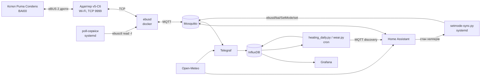

# Protherm Puma Condens 24/28 + eBUS + Home Assistant: повне керування й моніторинг без кімнатного регулятора

**Українська** | [English](README.en.md)

Як у мене влаштовано керування газовим котлом **Protherm Puma Condens 24/28 MKV-AS/1** з Home Assistant через eBUS: задання температури опалення та ГВП, погодозалежне опалення, круглі термостати, сповіщення, облік газу, графіки й аналітика. Кімнатного регулятора Vaillant/Protherm (VRC700, sensoCOMFORT, MiGo, ThermoLink) **немає**: роль регулятора виконує Home Assistant, який шле котлу команду `SetMode`.

Працює з липня 2026, весь опалювальний сезон.

---

## 1. Залізо

| Що | Деталі |
|---|---|
| Котел | Protherm Puma Condens 24/28 MKV-AS/1 (двоконтурний, тепла підлога через змішувальний вузол) |
| Ідентифікатор на шині | `MF=Vaillant;ID=BAI00;SW=5011;HW=1303`, product ID `0010026149` |
| eBUS-адаптер | ebusd adapter **v5-C6** (ESP32-C6), підключений до клем eBUS котла, працює по Wi-Fi/TCP (режим `ens:` = enhanced) |
| Сервер | одноплатник з Armbian, Docker |
| Телефон | Home Assistant Companion (Android) для push-сповіщень |

## 2. Загальна схема



Усе на одному сервері в Docker: `ebusd`, `homeassistant`, `influxdb:2.7`, `telegraf`, `grafana`, Mosquitto (на хості).

### Структура репозиторію

```
ebusd/docker-run.sh                 запуск контейнера ebusd
server/setmode-sync.py              демон, що шле котлу SetMode
server/ebusd-flame-poll.sh          примусове опитування полум'я/модуляції/ГВП/тиску (3 с)
server/ebusd-temp-poll.sh           примусове опитування подачі/обратки (5 с)
server/systemd/*.service            юніти для трьох скриптів + закриття порту 8888
server/cron/root.crontab            рідкісні примусові читання (лічильники, помилка)
server/cron/heating_daily           cron для аналітики
homeassistant/packages/kotel.yaml   УСЕ для HA: сенсори, хелпери, погода, крива, термостати, автоматизації
homeassistant/dashboards/kotel.json дашборд котла (sections)
monitoring/telegraf.conf            MQTT -> InfluxDB + погода
analytics/heating_daily.py          газ на опалення/ГВП, газ на градусо-день
analytics/wear.py                   ресурс вузлів котла -> HA (MQTT discovery)
```

### Встановлення (коротко)

1. **Адаптер і ebusd.** Підключіть адаптер до клем eBUS котла, впишіть його IP у `ebusd/docker-run.sh` і запустіть скрипт. Перевірка: `docker exec ebusd ebusctl info` має показати `signal: acquired` і `scanned "MF=Vaillant;ID=BAI00..."`.
2. **Mosquitto** на хості, порт 1883, і інтеграція MQTT у HA.
3. **Home Assistant.** Скопіюйте `homeassistant/packages/kotel.yaml` у `config/packages/` і додайте в `configuration.yaml`:
   ```yaml
   homeassistant:
     packages: !include_dir_named packages
   ```
   У пакеті замініть `notify.mobile_app_YOUR_PHONE` на свій сервіс сповіщень і координати в `rest:` на свої. Після перезапуску HA з'являться сенсори, хелпери, `climate.kotel_opalennia` і `climate.kotel_gvp`.
4. **Керування.** Покладіть `server/setmode-sync.py` у `/usr/local/bin/`. У скрипті вкажіть свій шлях до бази HA (`DB = ...home-assistant_v2.db`), бо він читає стан хелперів напряму з SQLite. Потрібен `mosquitto_pub` (пакет `mosquitto-clients`). Скопіюйте юніти в `/etc/systemd/system/`, далі `systemctl daemon-reload` і `systemctl enable --now setmode-sync ebusd-flame-poll ebusd-temp-poll ebusd-block-lan`. Записи crontab додайте з `server/cron/`.
5. **Дашборд.** Створіть новий дашборд, відкрийте «Редагувати → Raw configuration editor» і вставте вміст `homeassistant/dashboards/kotel.json` (JSON — це валідний YAML). Потрібні картки з HACS: `mushroom`, `mini-graph-card`, `apexcharts-card`. Картки ресурсу вузлів з'являться після першого запуску `wear.py`.
6. **Історія та аналітика (необов'язково).** InfluxDB 2 + Telegraf з `monitoring/telegraf.conf` (токен у змінній `INFLUX_TOKEN`) + Grafana. Скрипти з `analytics/` покладіть у `/root/heating_log/` і запускайте з cron.

Назви сутностей українські. Якщо перейменуєте хелпери, змініть їх і в `setmode-sync.py`.

## 3. ebusd

```bash
docker run -d --name ebusd --network host --restart unless-stopped \
  -v /opt/ebusd/config:/etc/ebusd/config \
  john30/ebusd:latest \
  --device=ens:<IP_АДАПТЕРА>:9999 \
  --scanconfig --configpath=https://ebus.github.io/ \
  --latency=50000 --pollinterval=5 \
  --mqtthost=127.0.0.1 --mqttport=1883 --mqttjson --mqtttopic=ebusd \
  --mqttclientid=ebusd --mqttchanges --mqttretain \
  --mqttint=/etc/ebusd/config/mqtt-hassio.cfg --mqttverbose \
  --mqttvar=filter-direction=r|u|^w \
  --httpport=8889 --enabledefine \
  --accesslevel=install
```

Що важливо:

- **`--accesslevel=install` обов'язковий для запису.** Без нього `SetMode` мовчки ігнорується: помилки немає, але котел нічого не отримує.
- ebusd підвантажує `vaillant/08.bai.csv` + `vaillant/bai.308523.inc`. Для HW=1303 / product 0010026149 окремого опису немає, тому береться запасний `bai.308523.inc`. Більшість регістрів читається, але близько 14 повертають відповідь нульової довжини (`/ 00`), тобто в цій прошивці їх просто немає (див. розділ 10).
- `mqtt-hassio.cfg` дає автодискавері в HA (понад 1400 сутностей). Я їх не використовую напряму: усі потрібні сенсори описані вручну в `configuration.yaml` (розділ 5), а `*.ebusd_bai_*` виключені з recorder, щоб не роздувати базу.
- Керувальний порт 8888 закритий від LAN (ufw + правило iptables), доступ тільки з localhost.

## 4. Керування: `SetMode` і скрипт `setmode-sync.py`

### 4.1 Команда SetMode

Котел приймає від «регулятора» повідомлення `bai SetMode`. Поля (з поточного конфігу ebusd):

```
hcmode ; flowtempdesired ; hwctempdesired ; hwcflowtempdesired ; disablehc ; disablehwctapping ; disablehwcload ; remotecontrolhcpump ; releasebackup ; releasecooling
```

Публікація в MQTT:

```bash
mosquitto_pub -t ebusd/bai/SetMode/set -m "auto;50;43;43;0;0;0;0;0;0;0;0"
#                                        hcmode;подача;ГВП;ГВП;...
```

Перевірено на практиці (на двох однакових котлах, SW 5011 і 5013):

| Параметр | Що приймає котел |
|---|---|
| Подача опалення `flowtempdesired` | 20…75 °C. ≤15 означає «немає запиту на опалення», ≥80 обрізається до 75 (= d.71) |
| ГВП `hwctempdesired` | 25…55 °C. ≤20 означає «немає запиту ГВП», ≥60 обрізається до 55 (= d.20) |
| `hcmode` | **не керується з шини**: літо/зима (опалення вимкнене/увімкнене) перемикається тільки кнопкою на панелі котла |
| Тайм-аут | без повторних команд котел тримає задане значення не більше ~16 хв, потім повертається до значень панелі |

Через тайм-аут команду треба повторювати постійно, а не один раз.

### 4.2 Скрипт `/usr/local/bin/setmode-sync.py`

Демон під systemd (`Type=simple`, `Restart=always`, `RestartSec=5`). Логіка:

- Читає стан чотирьох хелперів HA:
  - `input_boolean.boiler_heating_switch` + `input_number.boiler_heating_temp` (35–60 °C);
  - `input_boolean.zapit_na_gvp_kotla` + `input_number.temperatura_gvp_kotla` (35–55 °C).
- Стан читає **напряму з бази recorder HA (SQLite, read-only)**, без REST API і токена.
- Якщо обидва тумблери вимкнені, нічого не пише: котлом керує панель.
- Якщо увімкнений хоч один, шле `SetMode`. Для контуру, тумблер якого вимкнений, бере поточне значення котла (`FlowTempDesired` / `StorageTempDesired`), щоб не збити те, що стоїть на панелі (passthrough).
- Темп: кожні **2 с**, коли є активність (полум'я, водорозбір або увімкнений тумблер), і раз на **60 с** у простої.
- Значення перевіряються на допустимий діапазон перед відправкою. Усі записи пишуться в `/var/log/setmode-sync.log`.

```python
def run_once():
    heating_on = get_state("input_boolean.boiler_heating_switch") == "on"
    hwc_on     = get_state("input_boolean.zapit_na_gvp_kotla") == "on"
    if not (heating_on or hwc_on):
        return                      # керує панель котла

    flowtemp = get_state("input_number.boiler_heating_temp") if heating_on \
               else ebus_read("FlowTempDesired")          # passthrough
    hwctemp  = get_state("input_number.temperatura_gvp_kotla") if hwc_on \
               else ebus_read("StorageTempDesired")       # passthrough

    payload = f"auto;{flowtemp:g};{hwctemp:g};{hwctemp:g};0;0;0;0;0;0;0;0"
    subprocess.run(["mosquitto_pub", "-h", "127.0.0.1",
                    "-t", "ebusd/bai/SetMode/set", "-m", payload])
```

## 5. Сенсори в Home Assistant

Описані вручну через `mqtt:` у `configuration.yaml` (стабільні `unique_id`, українські назви). Приклад:

```yaml
mqtt:
  sensor:
    - name: "Котел: Температура подачі (факт)"
      unique_id: kotel_temperatura_podachi_fakt
      state_topic: "ebusd/bai/FlowTemp"
      value_template: "{{ value_json.temp.value }}"
      unit_of_measurement: "°C"
      device_class: temperature
      state_class: measurement
  binary_sensor:
    - name: "Котел: Полум'я"
      unique_id: kotel_polum_ia
      state_topic: "ebusd/bai/Flame"
      value_template: "{{ value_json.value.value }}"
      payload_on: "on"
      payload_off: "off"
```

Повний список: тиск води; подача (факт і задана); обратка; подача й обратка зі `Status01`; модуляція; задана ГВП (`StorageTempDesired`); режим насоса; години роботи опалення, ГВП і насоса; кількість запусків опалення й ГВП; поточна помилка (`Currenterror`); рівень іонізації полум'я; витрата гарячої води (`HwcWaterflow`); лічильник спрацювань термообмежувача STB; невдалі запалення (загалом і по спробах 1–4); годин до ТО; позиція 3-ходового клапана; полум'я.

### 5.1 Примусове опитування

Пасивний кеш ebusd для деяких значень міг годинами не оновлюватися, поки котел стоїть, навіть з `--pollinterval=5`. Тому окремі systemd-сервіси (`bash while true` + `docker exec ebusd ebusctl read -f <поле>`, `Restart=always`):

| Сервіс / cron | Поля | Період |
|---|---|---|
| `ebusd-flame-poll.service` | Flame, ModulationDesired, HwcWaterflow, HwcDemand, WaterPressure | 3 с |
| `ebusd-temp-poll.service` | FlowTemp, ReturnTemp | 5 с |
| cron | StorageTempDesired, HwcWaterflow | 2 хв |
| cron | HcHours, HwcHours, PumpHours, HcStarts, HwcStarts, Currenterror, IonisationVoltageLevel | 1 год |

Як перевірити свіжість конкретного значення: `ebusctl find -V -e <поле>`, поле `lastup` (час у UTC).

### 5.2 Похідні сенсори (template)

- **Фактичне навантаження:** `ModulationDesired` у простої часто тримається на 25 % (мінімум пальника). Тому навантаження = модуляція, якщо є полум'я, інакше 0.
- **Пальник на ГВП:** полум'я + витрата гарячої води > 0.
- **Перегрів ГВП:** подача ≥ 85 °C під час водорозбору або протягом 90 с після нього (`delay_off` 2 хв), плюс лічильники `history_stats` «перегрівів сьогодні / за 7 днів», «запусків ГВП сьогодні / за годину».

### 5.3 Облік газу (розрахунковий)

Лічильник газу не електронний, тому витрата рахується з модуляції:

```yaml
- name: "Котел: Розрахункова витрата газу"     # м³/год
  state: >-
    
              {# Qmax по ГВП-контуру з паспорта #}
      {# підібрано під реальний лічильник #}
    
      {{ ((modulation / 100) * max_gas_kw / calorific_kwh_m3) | round(3) }}
     0 
```

Далі `integration` дає м³, а `utility_meter` дає добовий і місячний підсумок. Є хелпер для показів реального лічильника та ціна газу (грн/м³). Після калібрування теплотворності по реальному лічильнику похибка близько 2 % за добу.

## 6. Погодозалежне опалення (в Home Assistant)

Вуличного датчика в котла немає, тому вулична температура береться з **Open-Meteo** (без ключа). Для теплої підлоги, яка реагує повільно, використовується **середнє прогнозу на 12 годин**, а не поточна температура:

```yaml
rest:
  - resource: https://api.open-meteo.com/v1/forecast?latitude=<LAT>&longitude=<LON>&current=temperature_2m&hourly=temperature_2m&forecast_hours=12&timezone=Europe%2FKyiv
    scan_interval: 900
    sensor:
      - name: "Outdoor temperature"
        value_template: "{{ value_json.current.temperature_2m }}"
      - name: "Outdoor temperature 12h"
        value_template: >-
          
          {{ (t | sum / t | count) | round(1) }}
```

Крива (лінійна інтерполяція між точками):

| Вулиця, °C | −12 | −7.5 | −2.5 | +2.5 | +7.5 | +12 |
|---|---|---|---|---|---|---|
| Подача, °C | 60 | 58 | 55 | 51 | 48 | 45 |

```yaml
template:
  - sensor:
      - name: "Heating weather target"
        unique_id: opalennia_temp_za_pogodoiu
        unit_of_measurement: "°C"
        state: >-
          
          {{ none }}
            
            
            
            
            
              
                
                
                  
                
              
            
            {{ ns.v | round(0) | int }}
          
```

Тумблер `input_boolean.opalennia_za_pogodoiu`. Автоматизація «Опалення за погодою» спрацьовує при зміні тумблера, при зміні цілі, кожні 30 хв і при старті HA. Вона записує ціль у `input_number.boiler_heating_temp` і вмикає `boiler_heating_switch`, а далі `setmode-sync.py` відправляє значення котлу. Вимкнули тумблер — керування повертається панелі.

Мінімум 45 °C свідомо: нижче котел частіше тактує, а температуру підлоги однаково обмежує змішувальний вузол.

## 7. Круглі термостати на дашборді

Щоб замість тумблерів і повзунків були звичайні картки `thermostat`, зроблено два віртуальні `climate` через MQTT. Це лише обгортка над тими самими чотирма хелперами:

```yaml
mqtt:
  climate:
    - name: "Котел: Опалення"
      unique_id: kotel_climate_opalennia
      modes: ["off", "heat"]
      mode_command_topic: "ha/kotel/opalennia/mode/set"
      mode_state_topic: "ha/kotel/opalennia/mode"
      temperature_command_topic: "ha/kotel/opalennia/temp/set"
      temperature_state_topic: "ha/kotel/opalennia/temp"
      current_temperature_topic: "ebusd/bai/FlowTemp"
      current_temperature_template: "{{ value_json.temp.value }}"
      action_topic: "ha/kotel/opalennia/action"
      min_temp: 35
      max_temp: 60
      temp_step: 1
      precision: 1.0
    - name: "Котел: ГВП"
      unique_id: kotel_climate_gvp
      modes: ["off", "heat"]
      mode_command_topic: "ha/kotel/gvp/mode/set"
      mode_state_topic: "ha/kotel/gvp/mode"
      temperature_command_topic: "ha/kotel/gvp/temp/set"
      temperature_state_topic: "ha/kotel/gvp/temp"
      action_topic: "ha/kotel/gvp/action"
      min_temp: 35
      max_temp: 55
      temp_step: 1
      precision: 1.0
```

Дві автоматизації:

- **команди → хелпери:** MQTT-тригер на `ha/kotel/+/…/set` переставляє `input_boolean` / `input_number`. «Вимк» на опаленні заодно вимикає і погодний режим, інакше він через 30 хв увімкнув би керування знову;
- **хелпери → стан:** при зміні хелперів, полум'я чи режиму пальника (та раз на 10 хв) публікує retained `mode` / `temp` / `action`. `action` = `heating`, коли пальник гріє саме цей контур.

«Вимк» тут означає «HA не керує, котлом керує панель», а не вимкнення котла. Фактичної температури ГВП у двоконтурного котла на шині немає (`HwcTemp` / `StorageTemp` = `cutoff`), тому термостат ГВП показує тільки задану.

## 8. Сповіщення

Push на телефон (HA Companion):

- **Код помилки котла:** при зміні `Currenterror` на будь-що, крім «Немає»;
- **Спрацювання термообмежувача STB:** при зростанні лічильника;
- **Немає зв'язку з котлом:** `ebusd` signal / running = off протягом певного часу або дані не оновлюються.

Додатково голосові оголошення на телевізор (TTS через DLNA) про помилку котла. Ця автоматизація в пакет не входить, бо прив'язана до конкретного телевізора.

Усі три автоматизації є в `homeassistant/packages/kotel.yaml`.

## 9. Історія, графіки, аналітика

- **Telegraf** (`inputs.mqtt_consumer`, топіки `ebusd/bai/+`, JSON) пише в **InfluxDB 2.7** (bucket `ebus`). Полум'я `on/off` перетворюється в 1/0 через `processors.enum`. Погода з Open-Meteo (температура, вологість, вітер, хмарність, сонячна радіація) іде через `inputs.http` кожні 15 хв.
- **Grafana:** дашборди на цих даних (температури, модуляція, полум'я, газ, погода).
- **`heating_daily.py`** (cron щогодини): денна аналітика з Influx — газ на опалення окремо від газу на ГВП (горіння з водорозбором > 0.5 л/хв вважається ГВП), середня задана подача, погода, **газ на градусо-день** (база 18 °C). Результат пишеться в Influx (`heating_daily`) і в CSV. `--report` дає зведення «газ на градусо-день залежно від температури подачі», щоб підібрати криву за реальними даними.
- **`wear.py`** (cron щогодини): «ресурс вузлів» за лічильниками котла (FanHours, FanStarts, PumpHours, ValveStarts) відносно типового ресурсу (вентилятор 30 000 год, запалювання 200 000 запусків, насос 50 000 год, 3-ходовий клапан 100 000 перемикань). Темп зносу береться з Influx, прогноз у роках. Публікує в HA через MQTT discovery.

На дашборді котла: стан (полум'я, навантаження, помилка, тиск), температури, газ і вода (день/місяць, гривні), ГВП (запуски, перегріви), напрацювання й ресурс вузлів, погодний режим, ручне керування (термостати).

## 10. Що з'ясувалося і обмеження

1. **Літо/зима (`hcmode`) з шини не перемикається.** Опалення треба ввімкнути кнопкою на панелі, далі HA керує температурою.
2. **ГВП максимум 55 °C** (обмеження d.20), більше котел обрізає.
3. **Тайм-аут SetMode** близько 16 хв, тому команду треба повторювати постійно (див. скрипт).
4. **Регістри, яких немає в прошивці** (відповідь нульової довжини): `ValveMode`, `WPPostrunTime`, `Status`, `ExternalFlowTempDesired`, `VortexFlowSensor`, `HwcTempDesired`, `Status16`, `SecondPumpMode`, `HwcTempMax`, `HcPumpMode`, `HwcPostrunTime`, `HoursTillService`, `ExtFlowTempDesiredMin`, також `HeatingSwitch`. ebusd безкінечно їх перепитує (~2,5 тис. невдалих читань на добу), на роботу це не впливає. Задана ГВП читається з `StorageTempDesired`. Issue: [john30/ebusd-configuration#698](https://github.com/john30/ebusd-configuration/issues/698).
5. **Кеш ebusd може бути застарілим:** див. 5.1, перевіряйте `lastup`.
6. **Перегрів ГВП при малому розборі:** мінімальна потужність пальника близько 25 % від 28 кВт, і при малій витраті води подача злітає до 85–92 °C. Програмно це не лікується (d.77 стосується бойлера, а не мінімальної модуляції). Рішення — термостатичний змішувальний клапан на виході ГВП.
7. **Журнал docker:** без `log-opts` журнал ebusd ріс до 100+ МБ. У `/etc/docker/daemon.json` додано `"log-opts": {"max-size": "10m", "max-file": "3"}`.
8. **Безпека:** ebusd, InfluxDB і Grafana не виставляти в LAN без потреби. Порти 8888/8889 закриті ufw, віддалений доступ до HA тільки через Tailscale.

## 11. Корисні команди

```bash
docker exec ebusd ebusctl info                         # стан шини, signal, loaded config
docker exec ebusd ebusctl find -c bai -V -e            # усі значення котла + lastup
docker exec ebusd ebusctl read -f FlowTempDesired      # примусове читання
mosquitto_sub -v -t 'ebusd/bai/#'                      # що летить у MQTT
tail -f /var/log/setmode-sync.log                      # що шле скрипт
```

---

Питання та доповнення пишіть у коментарях. Особливо цікаво порівняти з іншими версіями прошивки Puma / Jaguar / Panther Condens.
